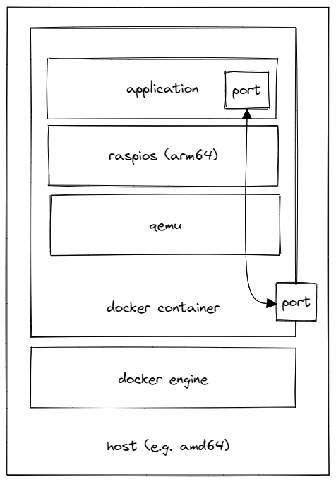

# Docker Virtual Raspberry Pi

Runs a virtual Raspberry Pi 3B+ with the latest Raspberry Pi OS Lite (64-bit) in a docker container using QEMU.

<div align="center">
	
</div>

## Quickstart

```shell
docker build -t vpi .
docker run -it -p 5022:5022 -v vpi-data:/data --stop-timeout 60 --name vpi vpi
```

The serial console is attached to the terminal: log in as `pi`, `Ctrl-P Ctrl-Q` detaches, `Ctrl-A X` quits QEMU.
Once booted, connect via SSH:

```shell
ssh -p 5022 pi@localhost   # password: raspberry
```

The first start takes several minutes: the image is unpacked, the root partition is grown and Raspberry Pi OS runs its first-boot setup.
Later boots take about a minute.
The SD card lives in the `vpi-data` volume, so changes persist across `docker stop`/`docker start` and container re-creation.
Delete the volume to start over.

`docker stop` shuts the Pi down cleanly via SSH, using a key the container generates on first start (`/data/shutdown_key`), and only cuts the power if that fails.
Shutting down takes about 7 seconds, close to Docker's default timeout of 10 seconds, so allow more, e.g. `docker stop -t 60 vpi` or `docker run --stop-timeout 60 ...`.

## Configuration

Environment variables (all but `PORTS` are applied on the first start only, when the volume is empty):

| Variable         | Default       | Description                                    |
|------------------|---------------|------------------------------------------------|
| `PI_PASSWORD`    | `raspberry`   | Password of the user `pi`                      |
| `PI_HOSTNAME`    | `raspberrypi` | Hostname                                       |
| `SSH_PUBLIC_KEY` |               | Public key authorized for the user `pi`        |
| `DISK_SIZE`      | `8G`          | SD card size, must be a power of 2             |
| `PORTS`          |               | Additional ports forwarded from the container to the Pi, e.g. `8080 3000:80` (`container_port:pi_port`); SSH is always on `5022` |

Build arguments select the Raspberry Pi OS release:

| Argument         | Default                                    |
|------------------|--------------------------------------------|
| `RASPIOS_URL`    | Raspberry Pi OS Lite (64-bit) 2026-10-06   |
| `RASPIOS_SHA256` | checksum of that release; leave empty to use the `.sha256` published next to the image |

```shell
docker build -t vpi \
  --build-arg RASPIOS_URL=https://downloads.raspberrypi.com/raspios_lite_arm64_latest \
  --build-arg RASPIOS_SHA256= .
```

## Example: Application on the Pi

[`example`](example) is an image built `FROM` this one that runs a small web server on the Pi, reachable from the host as shown in the figure above.

```shell
docker build -t vpi .
docker build -t vpi-example example
docker run -it -p 8080:8080 -v vpi-example-data:/data --stop-timeout 60 --name vpi-example vpi-example

curl localhost:8080
```

Images built on top of this one put their files into `/vpi/setup`.
On the first start, they are copied to `/boot/firmware/setup` on the Pi, and `setup.sh` runs once as root after the network is up, here to install the server as a systemd service.
`PORTS` forwards the application port from the container to the Pi.

## How it works

- QEMU 10 from Debian emulates the `raspi3b` machine: Cortex-A53, 1GB RAM, SD card, USB networking (`usb0`).
- On every (re)boot, kernel, initramfs, device tree and `cmdline.txt` are read from the image's own boot partition, like the real Pi firmware does. Kernel updates via `apt` therefore apply. QEMU runs with `-no-reboot` and the entrypoint restarts it whenever the Pi reboots.
- First boot is configured the way Raspberry Pi Imager does it, via files on the boot partition: `ssh` (SSH server), and cloud-init `user-data` (user, password, hostname, SSH key) and `network-config` (DHCP on `usb0`, which Raspberry Pi OS otherwise treats as a link-local USB gadget link).
- The Bluetooth node is removed from the device tree (like `dtoverlay=disable-bt`), so the PL011 UART (`ttyAMA1`) is a regular serial console with a login prompt.

## Known Issues

- Only the Raspberry Pi 3B+ is usable. QEMU emulates a Pi 4B, but without PCIe, USB and Ethernet, so it has no network; the Pi 5 is not emulated at all.
- Emulation is slow, since there is no hardware acceleration.
- QEMU's BCM2835 watchdog resets the machine as soon as it is armed, so the watchdog is disabled via the kernel command line (`watchdog_disarm=0 systemd.watchdog_sec=off`).
- A `poweroff` inside the Pi behaves like a reboot; stop the container instead.
- If `docker stop` times out, Docker kills QEMU, which is like pulling the plug: recent writes may be lost.
- Bluetooth, Wi-Fi, GPIO and the display are not emulated.

## Credits and Additional Links

- https://www.qemu.org/docs/master/system/arm/raspi.html
- https://github.com/lukechilds/dockerpi
- https://github.com/dhruvvyas90/qemu-rpi-kernel
- https://www.raspberrypi.com/software/operating-systems/
